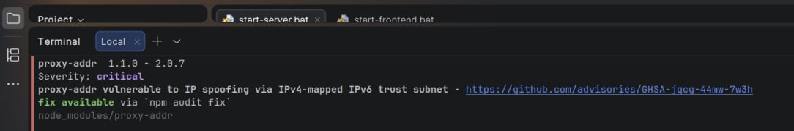
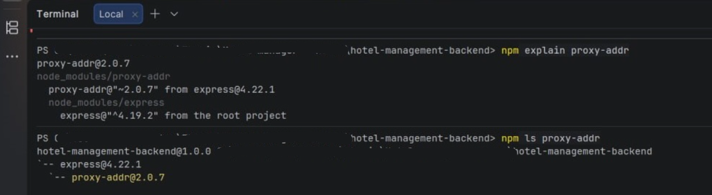
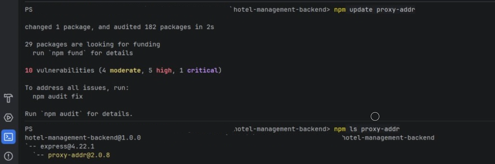
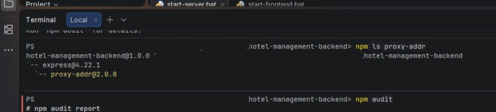

# Critical Vulnerability Investigation — proxy-addr

## 1. Project Overview

This investigation is part of my **Node.js Vulnerability Assessment** project.

I investigated a critical vulnerability in the `proxy-addr` package used by my Hotel Management System backend.

**Goal:** Understand the vulnerability, identify the affected dependency, apply a security update, and verify the result.

**Tools:** npm audit, npm explain, npm ls, PowerShell.

---

## 2. Understanding the Vulnerability

### What is a Proxy Server?

A **proxy server** is a server between a user and an application.

Instead of connecting directly to the application, the user's request goes through the proxy.

Example:

```text
User
  |
  v
Proxy Server
  |
  v
Web Application
```

A proxy can forward requests, improve performance, and provide additional security controls.

### What is Express?

**Express.js** is a Node.js framework used to build web applications and APIs.

My Hotel Management System uses Express in the backend to handle HTTP requests.

### What is proxy-addr?

`proxy-addr` is a package used by Express to identify client IP addresses when requests pass through proxy servers.

For example:

```text
Client IP: 192.0.2.10
        |
        v
Proxy Server
        |
        v
Express Application
```

The application needs to know which IP address belongs to the real client.

`proxy-addr` helps Express decide which proxy servers are trusted.

### What is X-Forwarded-For?

`X-Forwarded-For` is an HTTP header commonly used by proxies to pass information about the original client's IP address.

Example:

```http
X-Forwarded-For: 192.0.2.10
```

However, this header can also be sent or modified by a client. The application must not trust it automatically.

### What is IP Spoofing?

**IP Spoofing** means making a system believe that a request comes from a different IP address.

In this vulnerability, incorrect trusted-proxy configuration could allow an attacker to control the client IP address reported by Express.

Possible consequences:

- Incorrect IP addresses in security logs.
- Bypassing some IP-based access restrictions.
- Bypassing IP-based rate limiting.

**Example:** A security system blocks an IP address after too many failed login attempts. If an attacker can control the IP address that the application believes is the client IP, that protection may not work correctly.

### Why is this vulnerability Critical?

The vulnerability can affect important security decisions based on client IP addresses.

However, the presence of a vulnerable package does not automatically mean that the application can be attacked.

The actual risk depends on the application's proxy configuration and how it uses client IP addresses.

---

## 3. Vulnerability Details

| Field | Details |
|---|---|
| Package | proxy-addr |
| Severity | Critical |
| CVSS | 9.1 |
| CVE | CVE-2026-90711 |
| Type | IP Spoofing |
| Vulnerable version | 2.0.7 |
| Patched version | 2.0.8 |
| Advisory | [GHSA-jqcg-44mw-7w3h](https://github.com/advisories/GHSA-jqcg-44mw-7w3h) |

---

## 4. Detection — Finding the Vulnerability

### Step 1: Run a security scan

I opened the backend project in PowerShell and executed:

```bash
npm audit
```

**What does npm audit do?**

`npm audit` checks project dependencies for known security vulnerabilities.

The initial scan found:

- 11 vulnerable dependencies
- 2 Critical
- 5 High
- 4 Moderate

The report included a Critical vulnerability in `proxy-addr`.



**Result:** I identified a vulnerable dependency that required further investigation.

---

## 5. Investigation — Finding the Root Cause

### Step 2: Investigate the dependency

Command:

```bash
npm explain proxy-addr
```

**What does this command do?**

It explains why a package is installed and which other package requires it.

The result showed that `proxy-addr` was installed through Express.

### Step 3: Check the installed version

Command:

```bash
npm ls proxy-addr
```

**What does this command do?**

It displays the installed package version and its dependency chain.

Result:

```text
express@4.22.1
└── proxy-addr@2.0.7
```

This means:

- My backend uses Express 4.22.1.
- Express depends on `proxy-addr`.
- The installed version was 2.0.7.

This is called a **transitive dependency**: a package installed automatically because another package needs it.



**Result:** I confirmed the vulnerable version and identified Express as the package that required it.

---

## 6. Remediation — Fixing the Vulnerability

### Step 4: Update the package

Command:

```bash
npm update proxy-addr
```

**What does this command do?**

It updates the dependency within the versions allowed by the project.

In this case, version 2.0.8 contained the security fix and was compatible with the existing Express version requirement.

**Before:**

```text
proxy-addr@2.0.7
```

**After:**

```text
proxy-addr@2.0.8
```

The update also reduced the number of reported vulnerabilities from 11 to 10.



**Result:** The vulnerable package was updated to its patched version without changing the installed Express version.

---

## 7. Verification — Checking the Fix

### Step 5: Verify the installed version

Command:

```bash
npm ls proxy-addr
```

Result:

```text
express@4.22.1
└── proxy-addr@2.0.8
```



This confirmed that the patched version was installed.

### Step 6: Application Smoke Test

I started both the backend and frontend after updating the dependency.

The application started successfully.

A **smoke test** is a basic check to see whether the main parts of an application still work after a change.

This does not replace complete functional or security testing.

### Step 7: Security Rescan

A final `npm audit` verification is pending.

The next step is to confirm that the `proxy-addr` advisory no longer appears in the audit report.

---

## 8. Conclusion

During this investigation, I:

1. Detected a critical vulnerability using `npm audit`.
2. Learned how Express identifies client IP addresses.
3. Investigated the vulnerable transitive dependency.
4. Updated `proxy-addr` from 2.0.7 to 2.0.8.
5. Verified the installed version.
6. Confirmed that the application starts after the update.

**Final status:** Patched version installed. Final security rescan pending.

**Security note:** The original vulnerability's exploitability in this application was not confirmed.

---

## 9. Key Terms

| Term | Simple Definition |
|---|---|
| Proxy Server | A server between a client and an application. |
| Express.js | A Node.js framework for building web applications and APIs. |
| proxy-addr | A package that helps Express identify client IP addresses. |
| IP Spoofing | Making a system believe a request comes from another IP address. |
| X-Forwarded-For | An HTTP header that can contain the original client's IP address. |
| Vulnerability | A weakness that could create a security problem. |
| Dependency | A package that an application needs. |
| Transitive Dependency | A package installed because another package needs it. |
| Remediation | Fixing or reducing a security problem. |
| Patch | A software update that fixes a problem. |
| Verification | Checking that a fix was applied correctly. |
| Smoke Test | A quick check that an application still works. |

## Reference

[GitHub Security Advisory — CVE-2026-90711](https://github.com/advisories/GHSA-jqcg-44mw-7w3h)
