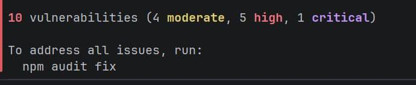
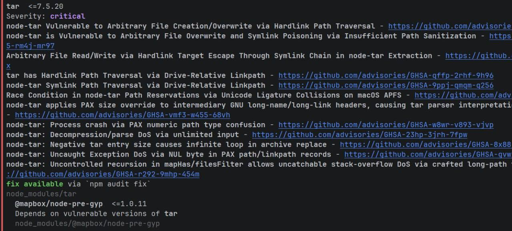
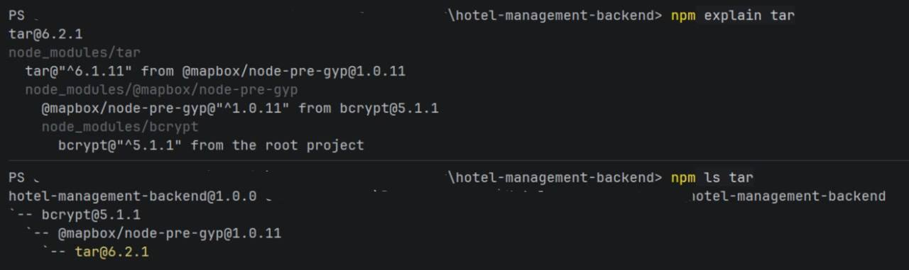
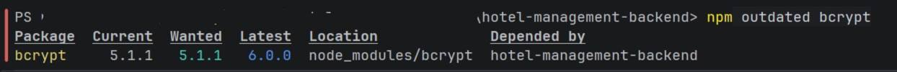
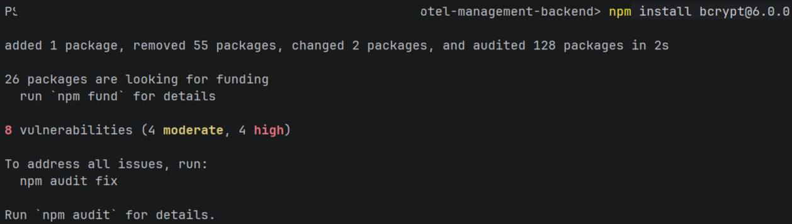
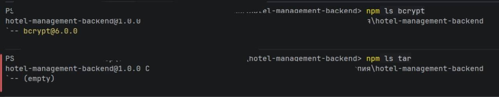
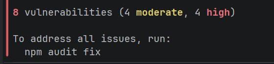

# Critical Vulnerability Investigation — TAR

## 1. Project Overview

This investigation is part of my **Node.js Vulnerability Assessment & Remediation** project.

During a security scan of my Hotel Management System backend, I discovered a critical vulnerability in the `tar` package.

**Goal:** Understand the vulnerability, identify why the package was installed, remove the vulnerable dependency, and verify that the application still works.

**Application:** Hotel Management System (Node.js, Express, MySQL)

**Tools:** npm audit, npm explain, npm ls, npm outdated, PowerShell.

**Result:** The vulnerable `tar` dependency was removed by updating `bcrypt` from version 5.1.1 to 6.0.0.

---

## 2. Understanding the Vulnerability

### What is TAR?

**TAR (Tape Archive)** is a file format used to store multiple files and folders in a single archive.

For example:

```text
backup.tar
├── users.json
├── settings.json
└── images/
```

Unlike ZIP, TAR does not automatically compress files. It is often combined with compression tools such as gzip.

In Node.js, the `tar` package helps applications create, read, and extract TAR archives.

### What is Path Traversal?

**Path Traversal** is a security vulnerability that allows a program to access files outside an intended directory.

For example, an application should extract an archive into:

```text
app/uploads/
```

However, a malicious archive might contain a path such as:

```text
../../config.json
```

The `../` sequence means moving to a parent directory.

If an archive extraction tool does not properly validate file paths, an attacker may be able to access or overwrite files outside the intended folder.

### What is a Symlink?

A **symbolic link (symlink)** is a special file that points to another file or directory.

Some TAR vulnerabilities involve malicious links that redirect file operations to unexpected locations.

### What is Denial of Service (DoS)?

A **Denial of Service (DoS)** attack makes an application or service unavailable.

For example, a specially created archive may cause excessive memory usage, high CPU usage, or an application crash.

### Why is this vulnerability dangerous?

The initial audit reported several security problems affecting the installed `tar` version, including:

- **Path Traversal:** Accessing files outside the expected directory.
- **Arbitrary File Overwrite:** Replacing files that should not be modified.
- **Symlink Attacks:** Using symbolic links to redirect file operations.
- **Denial of Service:** Causing excessive resource usage or crashes.

These problems may be serious when an application processes untrusted archives.

However, the presence of a vulnerable package does not automatically mean that an application is exploitable. The actual risk depends on how the package is used.

---

## 3. Initial Vulnerability Detection

### Step 1: Run npm audit

I ran the following command in my backend directory:

```bash
npm audit
```

**What does npm audit do?**

`npm audit` checks project dependencies against known security vulnerabilities.

After fixing a previous vulnerability in `proxy-addr`, the scan reported:

- **10 vulnerabilities**
- 1 Critical
- 5 High
- 4 Moderate



### Step 2: Identify the Critical Finding

The report identified the `tar` package as critically vulnerable.

**Vulnerability details:**

| Field | Details |
|---|---|
| Package | tar |
| Installed version | 6.2.1 |
| Severity | Critical |
| Main vulnerability types | Path Traversal, File Overwrite, DoS |
| Dependency source | bcrypt → @mapbox/node-pre-gyp → tar |
| Remediation approach | Update the parent dependency |

The report contained multiple security advisories affecting the installed version.



**Result:** I identified `tar` as the remaining Critical finding and started investigating why it was installed.

---

## 4. Dependency Investigation

### Step 3: Find out why TAR is installed

Command:

```bash
npm explain tar
```

**What does this command do?**

`npm explain` shows why a package is installed and which other packages depend on it.

The result showed the following dependency chain:

```text
Hotel Management Backend
└── bcrypt@5.1.1
    └── @mapbox/node-pre-gyp@1.0.11
        └── tar@6.2.1
```

### What is bcrypt?

**bcrypt** is a library used for password hashing.

Password hashing transforms a password into a value that can be used to verify it without storing the original password as plain text.

My Hotel Management System uses bcrypt for user authentication.

### What is @mapbox/node-pre-gyp?

`@mapbox/node-pre-gyp` is a package that helps install precompiled native components for Node.js applications.

The installed version depended on `tar` for archive operations.

### What is a Transitive Dependency?

A **transitive dependency** is a package installed automatically because another package requires it.

In this case:

- My project directly used `bcrypt`.
- `bcrypt` required `@mapbox/node-pre-gyp`.
- `@mapbox/node-pre-gyp` required `tar`.

This means I did not install `tar` directly.

### Step 4: Confirm the installed version

Command:

```bash
npm ls tar
```

Result:

```text
bcrypt@5.1.1
└── @mapbox/node-pre-gyp@1.0.11
    └── tar@6.2.1
```



**Result:** I confirmed that `tar@6.2.1` was installed indirectly through bcrypt.

---

## 5. Checking Available Versions

### Step 5: Check bcrypt updates

Command:

```bash
npm outdated bcrypt
```

**What does this command do?**

`npm outdated` compares the installed package version with the version allowed by the project and the latest published version.

The result was:

| Current | Wanted | Latest |
|---|---|---|
| 5.1.1 | 5.1.1 | 6.0.0 |

- **Current:** The installed version.
- **Wanted:** The highest version allowed by the current package requirements.
- **Latest:** The latest version published under the npm `latest` tag.



### Step 6: Check Node.js compatibility

Command:

```bash
node -v
```

Result:

```text
v24.15.0
```

The environment met the Node.js version requirement for bcrypt 6.0.0.

Updating bcrypt was a major version change, so application testing was necessary.

**Decision:** Update bcrypt to 6.0.0 and check whether the vulnerable `tar` dependency disappears.

---

## 6. Vulnerability Remediation

### Step 7: Update bcrypt

Command:

```bash
npm install bcrypt@6.0.0
```

**What does this command do?**

It installs bcrypt version 6.0.0 and updates the project's dependency files.

Instead of updating `tar` directly, I updated the parent dependency responsible for installing it.

**Installation output:**

```text
added 1 package
removed 55 packages
changed 2 packages

8 vulnerabilities (4 moderate, 4 high)
```



The number of reported vulnerabilities decreased from 10 to 8.

The installation also removed 55 packages from the dependency tree.

**Result:** Updating bcrypt removed the old dependency chain that included the vulnerable `tar` package.

---

## 7. Verification

### Step 8: Verify bcrypt

Command:

```bash
npm ls bcrypt
```

Result:

```text
bcrypt@6.0.0
```

This confirmed that the new bcrypt version was installed.

### Step 9: Verify TAR Removal

Command:

```bash
npm ls tar
```

Result:

```text
(empty)
```

The `(empty)` result means that `tar` was no longer present in the installed dependency tree.



### Step 10: Test Application Authentication

After updating bcrypt, I started the backend and frontend of my Hotel Management System.

I tested login using an existing test account.

**Result: Login successful.**

This confirmed that the tested authentication flow continued working after the bcrypt update.

This was a basic functional test, not a complete test of the application.

### Step 11: Final Security Rescan

I ran another security scan:

```bash
npm audit
```

**Results:**

| Severity | Before TAR Remediation | After TAR Remediation |
|---|---:|---:|
| Critical | 1 | 0 |
| High | 5 | 4 |
| Moderate | 4 | 4 |
| **Total** | **10** | **8** |

The final scan reported no Critical vulnerabilities.

The previously reported `tar` dependency was also absent from the installed dependency tree.



**Final Status: Remediated and Verified**

---

## 8. Conclusion

During this investigation, I:

1. Detected a Critical vulnerability using `npm audit`.
2. Investigated the dependency chain using `npm explain tar`.
3. Confirmed the installed version using `npm ls tar`.
4. Checked available bcrypt versions.
5. Updated bcrypt from 5.1.1 to 6.0.0.
6. Confirmed that the vulnerable `tar` dependency was removed.
7. Successfully tested login after the update.
8. Repeated `npm audit` and confirmed that no Critical findings remained.

### Final Results

- **bcrypt:** 5.1.1 → 6.0.0
- **tar:** 6.2.1 → Removed from installed dependencies
- **Vulnerability count:** 10 → 8
- **Critical findings:** 1 → 0
- **Authentication test:** Successful

**Security Note:** I did not confirm that the original `tar` vulnerabilities were exploitable in this application. The remediation removed the vulnerable dependency, but eight other vulnerability findings still require investigation.

---

## 9. Key Terms

| Term | Simple Definition |
|---|---|
| TAR | A file format used to store multiple files in one archive. |
| Path Traversal | Accessing files outside an intended directory. |
| Symlink | A special file that points to another file or folder. |
| File Overwrite | Replacing an existing file with other content. |
| DoS | An attack that makes a service unavailable. |
| bcrypt | A library used for password hashing. |
| Password Hashing | Transforming a password into a value used for secure verification. |
| Transitive Dependency | A package installed because another package needs it. |
| npm audit | A command that checks dependencies for known vulnerabilities. |
| npm explain | A command that shows why a dependency is installed. |
| npm ls | A command that displays installed packages and their versions. |
| npm outdated | A command that checks for newer package versions. |
| Remediation | Fixing or reducing a security problem. |
| Verification | Checking whether a fix was applied correctly. |

---

## 10. References

- [npm — tar package](https://www.npmjs.com/package/tar)
- [npm — bcrypt package](https://www.npmjs.com/package/bcrypt)
- [GitHub Security Advisory — TAR Path Traversal](https://github.com/advisories/GHSA-34x7-hfp2-rc4v)
- [npm audit documentation](https://docs.npmjs.com/cli/commands/npm-audit)
