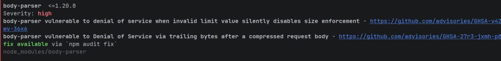
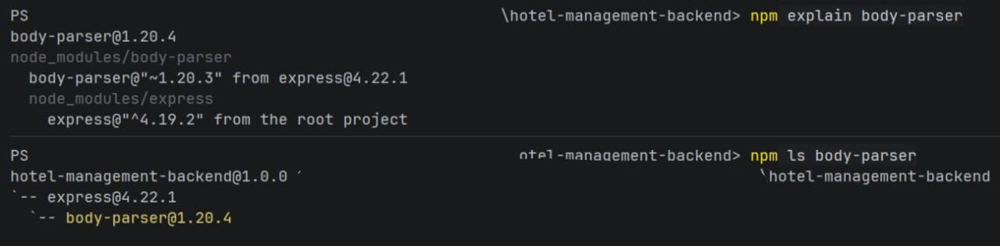
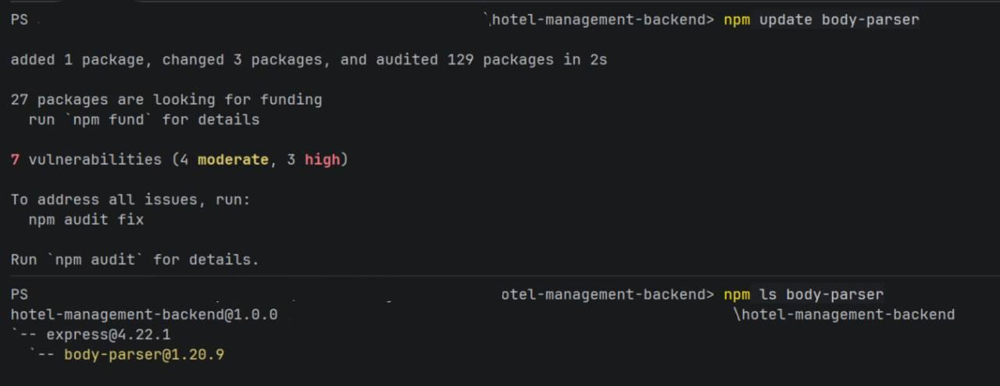
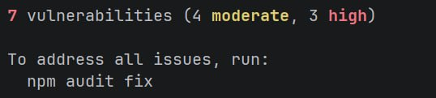

# High Vulnerability Investigation — body-parser

## 1. Project Overview

This investigation is part of my **Node.js Vulnerability Assessment & Remediation** project.

During a security scan of my Hotel Management System backend, I found security vulnerabilities in the `body-parser` package.

**Goal:** Understand the vulnerabilities, investigate the dependency, update the affected package, and verify that the application still works.

**Application:** Hotel Management System (Node.js, Express, MySQL)

**Tools:** npm audit, npm explain, npm ls, PowerShell.

**Result:** Updated `body-parser` from version 1.20.4 to 1.20.9. The number of reported vulnerabilities decreased from 8 to 7. The application login test was successful after the update.

---

## 2. Understanding the Vulnerability

### What is body-parser?

`body-parser` is a Node.js package used by Express to read the body of incoming HTTP requests.

For example, when a user logs into a website, the browser may send:

```json
{
  "email": "test@example.com",
  "password": "example-password"
}
```

The request body contains the data sent by the client.

`body-parser` converts this data into a format that the backend can work with, such as `req.body`.

### What is an HTTP Request Body?

An **HTTP request body** is the part of an HTTP request that contains data sent to the server.

It is commonly used when submitting forms, creating records, or sending JSON data to an API.

### What is Denial of Service (DoS)?

**Denial of Service (DoS)** is an attack that makes a service unavailable or unable to respond normally.

For example, an attacker may send specially prepared requests that cause a server to consume too much memory, use excessive CPU resources, or crash.

### What is a Request Size Limit?

A **request size limit** controls how much data the server accepts in a request body.

It helps protect the application from processing unexpectedly large requests.

For example, a server may limit JSON request bodies to 100 KB.

### What vulnerabilities were found?

The audit reported two security advisories:

**1. Invalid Request Size Limit**

Under certain configurations, an invalid `limit` value could disable the expected size restriction.

This could allow oversized request bodies to use excessive server resources.

**2. Compressed Request Body DoS**

A specially prepared compressed request body could cause an unhandled error and crash the application.

Both issues were addressed by updating to `body-parser@1.20.9`.

**Important:** Finding a vulnerable package does not automatically prove that the application can be attacked. The actual risk depends on how the application uses the package.

---

## 3. Vulnerability Details

| Field | Details |
|---|---|
| Package | body-parser |
| Severity reported by npm | High |
| Installed version | 1.20.4 |
| Patched version | 1.20.9 |
| Vulnerability type | Denial of Service (DoS) |
| Dependency source | Express |
| Remediation | Update body-parser |

**Security advisories:**

- [GHSA-v422-hmwv-36x6 — Invalid Size Limit](https://github.com/advisories/GHSA-v422-hmwv-36x6)
- [GHSA-27r3-jxmh-p828 — Compressed Request Body DoS](https://github.com/advisories/GHSA-27r3-jxmh-p828)

---

## 4. Detection — Finding the Vulnerability

### Step 1: Run a Security Scan

I ran:

```bash
npm audit
```

**What does this command do?**

`npm audit` checks project dependencies for known security vulnerabilities.

The scan identified vulnerable versions of `body-parser`.



**Result:** I identified two DoS-related security advisories affecting the installed package version.

---

## 5. Dependency Investigation

### Step 2: Identify Why the Package Is Installed

Command:

```bash
npm explain body-parser
```

**What does this command do?**

It explains why a package is installed and which other packages require it.

The result showed that `body-parser` was installed through Express.

### Step 3: Check the Installed Version

Command:

```bash
npm ls body-parser
```

**What does this command do?**

It shows the installed package version and its dependency chain.

Result:

```text
Hotel Management Backend
└── express@4.22.1
    └── body-parser@1.20.4
```

### What is a Transitive Dependency?

A **transitive dependency** is a package installed because another package needs it.

In this case, my project used Express, and Express required `body-parser`.



**Result:** I confirmed that the installed version was 1.20.4 and that the package was required by Express.

---

## 6. Remediation — Updating the Package

### Step 4: Update body-parser

Command:

```bash
npm update body-parser
```

**What does this command do?**

It updates the dependency to a newer compatible version allowed by the project's package requirements.

The installed version changed:

**1.20.4 → 1.20.9**

Express remained at version 4.22.1.

After updating, npm reported:

```text
added 1 package
changed 3 packages

7 vulnerabilities (4 moderate, 3 high)
```

### Why Was This Update Important?

Version 1.20.9 includes security fixes for the reported vulnerabilities.

The update allowed me to replace the vulnerable package without performing a major Express upgrade.



**Result:** The patched package version was installed, and the reported vulnerability count decreased from 8 to 7.

---

## 7. Verification — Checking the Results

### Step 5: Verify the Installed Version

I executed:

```bash
npm ls body-parser
```

Result:

```text
express@4.22.1
└── body-parser@1.20.9
```

This confirmed that the updated version was installed.

### Step 6: Security Rescan

I ran another security scan:

```bash
npm audit
```

Results:

| Severity | Before Update | After Update |
|---|---:|---:|
| Critical | 0 | 0 |
| High | 4 | 3 |
| Moderate | 4 | 4 |
| **Total** | **8** | **7** |



The updated package version was confirmed, and the overall number of reported vulnerabilities decreased.

### Step 7: Application Test

After updating `body-parser`, I started the backend and frontend of my Hotel Management System.

I tested the application using an existing test account.

**Test results:**

- Backend started successfully.
- Frontend started successfully.
- User login was successful.
- The application continued working after the dependency update.

**Result:** The tested login functionality worked correctly after the update.

This was a basic functional test, not a complete test of all application features.

---

## 8. Conclusion

During this investigation, I:

1. Detected known vulnerabilities using `npm audit`.
2. Learned how Express processes HTTP request bodies.
3. Investigated the transitive dependency.
4. Confirmed the vulnerable version of `body-parser`.
5. Updated the package from 1.20.4 to 1.20.9.
6. Verified the installed version.
7. Repeated the security scan.
8. Tested the application and confirmed that user login still worked.

### Final Results

- **body-parser:** 1.20.4 → 1.20.9
- **Express:** Remained at 4.22.1
- **Vulnerabilities:** 8 → 7
- **Critical findings:** 0
- **Remaining findings:** 3 High, 4 Moderate
- **Backend and frontend:** Started successfully
- **Login test:** Successful

**Final Status: Remediated and Verified**

The vulnerable package was updated, the security scan showed fewer vulnerabilities, and the tested login functionality continued working.

**Security Note:** The original vulnerabilities were not confirmed to be exploitable in this specific application. A successful login test also does not prove that every possible HTTP request scenario is safe.

---

## 9. Key Terms

| Term | Simple Definition |
|---|---|
| body-parser | A package used to read HTTP request bodies. |
| HTTP Request Body | Data sent from a client to a server in a request. |
| JSON | A common text format used to exchange structured data. |
| Express | A Node.js framework for building web applications and APIs. |
| DoS | An attack that makes a service unavailable. |
| Request Size Limit | A maximum allowed size for incoming request data. |
| Transitive Dependency | A package installed because another package needs it. |
| Remediation | Fixing or reducing a security problem. |
| Patch | A software update that fixes a problem. |
| Verification | Checking that an update was applied correctly. |

---

## 10. References

- [body-parser — npm](https://www.npmjs.com/package/body-parser)
- [GitHub Advisory — Invalid Request Size Limit](https://github.com/advisories/GHSA-v422-hmwv-36x6)
- [GitHub Advisory — Compressed Request Body DoS](https://github.com/advisories/GHSA-27r3-jxmh-p828)
- [npm audit Documentation](https://docs.npmjs.com/cli/commands/npm-audit)
