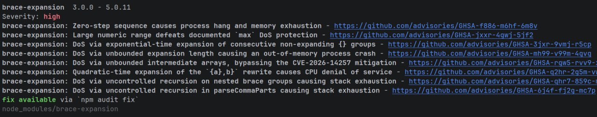
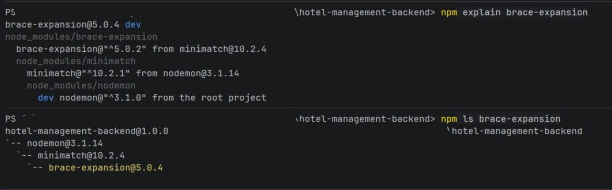
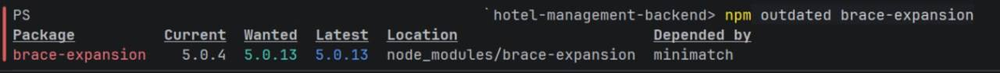
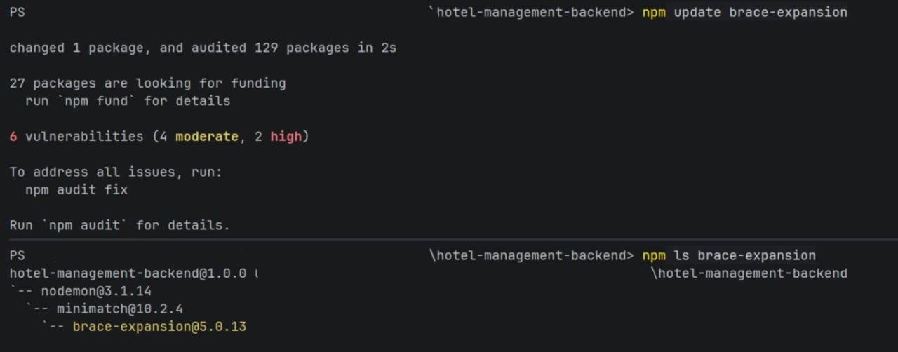
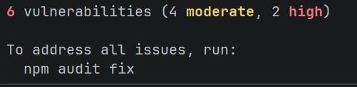

# High Vulnerability Investigation — brace-expansion

## 1. Project Overview

This investigation is part of my **Node.js Vulnerability Assessment & Remediation** project.

During a security scan of my Hotel Management System backend, I found multiple high-severity vulnerabilities in the `brace-expansion` package.

**Goal:** Understand the security risks, investigate the dependency chain, update the vulnerable package, and verify the results.

**Application:** Hotel Management System (Node.js, Express, MySQL)

**Tools:** npm audit, npm explain, npm ls, npm outdated, PowerShell.

**Result:** Updated `brace-expansion` from version 5.0.4 to 5.0.13. The total number of reported vulnerabilities decreased from 7 to 6. The application continued working after the update.

---

## 2. Understanding the Vulnerability

### What is brace-expansion?

`brace-expansion` is a JavaScript package that expands expressions inside curly braces into multiple strings.

For example:

```text
image{1..3}.png
```

The package expands this expression into:

```text
image1.png
image2.png
image3.png
```

Another example:

```text
{admin,user,guest}
```

Result:

```text
admin
user
guest
```

This functionality is useful in tools that work with file names and patterns.

### What is minimatch?

`minimatch` is a package used to match file paths against patterns.

For example, it can help find files that match:

```text
*.js
```

It uses `brace-expansion` to process expressions containing curly braces.

### What is DoS (Denial of Service)?

**Denial of Service (DoS)** is an attack that makes a service unavailable or unable to respond normally.

An attacker may send specially prepared input that causes a program to use excessive CPU resources or memory.

This can lead to:

- Application slowdown.
- High memory consumption.
- Process crashes.
- Service unavailability.

### What vulnerabilities were found?

The npm audit report identified several vulnerabilities in `brace-expansion`.

Examples included:

**1. Zero-step sequence**

A specially prepared expression can cause the process to hang and consume excessive memory.

**2. Large numeric ranges**

Large ranges can bypass expected protection limits and cause excessive resource consumption.

**3. Uncontrolled expansion**

Certain expressions can generate too many intermediate values and cause an out-of-memory crash.

**4. Uncontrolled recursion**

Nested expressions can cause excessive recursion and stack exhaustion.

**5. Excessive processing time**

Some specially constructed expressions can require too much CPU processing time.

These issues are related to Denial of Service.

**Important:** The audit identified known vulnerabilities in the package. Their actual exploitability in this application was not established.

---

## 3. Vulnerability Details

| Field | Details |
|---|---|
| Package | brace-expansion |
| Severity | High |
| Installed version | 5.0.4 |
| Updated version | 5.0.13 |
| Vulnerability type | Denial of Service (DoS) |
| Dependency source | minimatch |
| Parent dependency | nodemon |
| Dependency type | Development dependency |
| Remediation | Update brace-expansion |

**Security advisories:**

- [GHSA-f886-m6hf-6m8v](https://github.com/advisories/GHSA-f886-m6hf-6m8v)
- [GHSA-jxxr-4gwj-5jf2](https://github.com/advisories/GHSA-jxxr-4gwj-5jf2)
- [GHSA-3jxr-9vmj-r5cp](https://github.com/advisories/GHSA-3jxr-9vmj-r5cp)
- [GHSA-mh99-v99m-4gvg](https://github.com/advisories/GHSA-mh99-v99m-4gvg)
- [GHSA-rgw5-rvv9-x895](https://github.com/advisories/GHSA-rgw5-rvv9-x895)
- [GHSA-q2hr-2g5m-vwhr](https://github.com/advisories/GHSA-q2hr-2g5m-vwhr)
- [GHSA-qhr7-859c-m2p7](https://github.com/advisories/GHSA-qhr7-859c-m2p7)
- [GHSA-6j4f-fj2g-mc7p](https://github.com/advisories/GHSA-6j4f-fj2g-mc7p)

---

## 4. Detection — Finding the Vulnerability

### Step 1: Run a Security Scan

Command:

```bash
npm audit
```

**What does this command do?**

`npm audit` checks project dependencies against known security advisories.

The scan identified multiple high-severity vulnerabilities in `brace-expansion`.



**Result:** I identified the vulnerable package and reviewed the reported security issues.

---

## 5. Dependency Investigation

### Step 2: Find the Dependency Chain

Command:

```bash
npm explain brace-expansion
```

**What does this command do?**

It explains why a package is installed and which other packages require it.

The investigation revealed the following dependency chain:

```text
Hotel Management Backend
└── nodemon@3.1.14
    └── minimatch@10.2.4
        └── brace-expansion@5.0.4
```

### Step 3: Check Installed Versions

Command:

```bash
npm ls brace-expansion
```

This command displays the installed version and its dependency tree.

The package was installed through `minimatch`, which was required by `nodemon`.



### What is a Development Dependency?

A **Development Dependency** is a package used during software development rather than as a direct requirement of the production application.

In this case, `nodemon` was installed as a development dependency.

Nodemon automatically restarts the Node.js server when files change.

Although this package is mainly used during development, its security still matters, especially in developer environments and CI/CD pipelines.

---

## 6. Remediation — Updating the Package

### Step 4: Check Available Versions

Command:

```bash
npm outdated brace-expansion
```

**What does this command do?**

It checks whether a newer version of a package is available.

The result showed:

| Field | Version |
|---|---|
| Current | 5.0.4 |
| Wanted | 5.0.13 |
| Latest | 5.0.13 |

The reported vulnerable range was `3.0.0 - 5.0.11`.

Version 5.0.13 was outside this range and was selected for the update.



### Step 5: Update brace-expansion

Command:

```bash
npm update brace-expansion
```

**What does this command do?**

It updates the package to a newer version allowed by the dependency requirements.

The package was updated:

**5.0.4 → 5.0.13**

The update did not require changing the installed versions of `nodemon` or `minimatch`.

After the update, npm reported:

```text
6 vulnerabilities (4 moderate, 2 high)
```

### Step 6: Verify the Updated Version

Command:

```bash
npm ls brace-expansion
```

Result:

```text
nodemon@3.1.14
└── minimatch@10.2.4
    └── brace-expansion@5.0.13
```



**Result:** The updated version 5.0.13 was successfully installed.

---

## 7. Verification — Checking the Results

### Step 7: Security Rescan

I ran another security scan:

```bash
npm audit
```

The updated audit summary showed:

| Severity | Before Update | After Update |
|---|---:|---:|
| Critical | 0 | 0 |
| High | 3 | 2 |
| Moderate | 4 | 4 |
| **Total** | **7** | **6** |



**Result:** The total number of reported vulnerabilities decreased from 7 to 6.

The installed `brace-expansion` version was also confirmed to be outside the vulnerable version range reported in the initial audit.

### Step 8: Application Test

After updating the dependency, I tested the Hotel Management System.

**Test results:**

- Backend started successfully.
- Frontend started successfully.
- Nodemon worked without errors.
- The login page opened correctly.
- Login with an existing test account was successful.

**Result:** The application continued working after the dependency update.

---

## 8. Conclusion

During this investigation, I:

1. Detected high-severity vulnerabilities using `npm audit`.
2. Learned how brace expansion works.
3. Investigated the dependency chain using `npm explain`.
4. Identified `nodemon` as the parent development dependency.
5. Checked available versions using `npm outdated`.
6. Updated `brace-expansion` from 5.0.4 to 5.0.13.
7. Verified the installed version using `npm ls`.
8. Performed another security scan.
9. Tested the backend, frontend, and user authentication.

### Final Results

- **Package:** brace-expansion
- **Version:** 5.0.4 → 5.0.13
- **Parent dependency:** nodemon
- **Dependency type:** Development dependency
- **Total vulnerabilities:** 7 → 6
- **Remaining findings:** 2 High, 4 Moderate
- **Backend:** Working
- **Frontend:** Working
- **Login test:** Successful

**Final Status: Updated and Verified**

The vulnerable package was updated to a version outside the reported vulnerable range. The application passed the tested functionality checks after the update.

**Security Note:** The investigation confirmed the presence of vulnerable dependency versions, but did not establish that the original vulnerabilities were exploitable in this specific application.

---

## 9. Key Terms

| Term | Simple Definition |
|---|---|
| brace-expansion | A package that expands expressions inside curly braces. |
| minimatch | A package that matches file names against patterns. |
| nodemon | A development tool that automatically restarts Node.js. |
| DoS | An attack that makes a service unavailable. |
| Memory Exhaustion | Using too much memory until a process fails. |
| Stack Exhaustion | Using too much call stack memory, often due to recursion. |
| Development Dependency | A package needed during development. |
| Dependency Chain | A sequence of packages that depend on each other. |
| Remediation | Fixing or reducing a security problem. |
| Verification | Checking that a fix works correctly. |

---

## 10. References

- [brace-expansion — npm](https://www.npmjs.com/package/brace-expansion)
- [minimatch — npm](https://www.npmjs.com/package/minimatch)
- [nodemon — npm](https://www.npmjs.com/package/nodemon)
- [npm audit Documentation](https://docs.npmjs.com/cli/commands/npm-audit)
