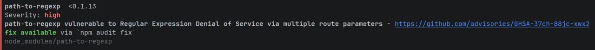
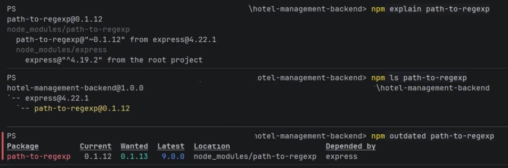
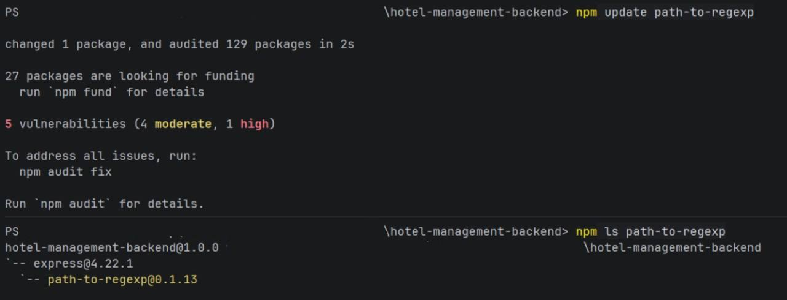
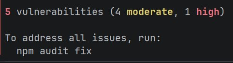

# High Vulnerability Investigation — path-to-regexp

## 1. Project Overview

This investigation is part of my **Node.js Vulnerability Assessment & Remediation** project.

During a security scan of my Hotel Management System backend, I found a high-severity vulnerability in the `path-to-regexp` package.

**Goal:** Understand the vulnerability, investigate the dependency, update the affected package, and verify that the application still works.

**Application:** Hotel Management System (Node.js, Express, MySQL)

**Tools:** npm audit, npm explain, npm ls, npm outdated, PowerShell.

**Result:** Updated `path-to-regexp` from version 0.1.12 to 0.1.13. The total number of reported vulnerabilities decreased from 6 to 5. The application continued working after the update.

---

## 2. Understanding the Vulnerability

### What is path-to-regexp?

`path-to-regexp` is a JavaScript package used to match URL paths against route patterns.

It is used by Express to help identify which route should handle an incoming HTTP request.

For example, consider this Express route:

```javascript
app.get('/api/rooms/:id', (req, res) => {
    const roomId = req.params.id;
});
```

Here:

- `/api/rooms/` is the fixed part of the URL.
- `:id` is a dynamic parameter.
- `15` is an example of a room ID.

When a user opens:

```text
/api/rooms/15
```

Express needs to match this URL with the correct route.

`path-to-regexp` helps with this process.

### What is a Regular Expression (Regex)?

A **Regular Expression** is a pattern used to search, match, or validate text.

For example, a regular expression can check whether a string follows a particular format.

URL routing libraries can use regular expressions to match incoming URLs against route patterns.

### What is ReDoS?

**ReDoS (Regular Expression Denial of Service)** is a type of Denial of Service attack.

It happens when a specially prepared input causes a regular expression to take an extremely long time to process.

This can lead to:

- High CPU usage.
- Slow application responses.
- Server performance problems.
- Application unavailability.

In this case, specially constructed route parameters could trigger excessive regular expression processing.

**Important:** The presence of a vulnerable package does not automatically mean that the application can be successfully attacked. Actual exploitability depends on how the vulnerable code is used.

---

## 3. Vulnerability Details

| Field | Details |
|---|---|
| Package | path-to-regexp |
| Severity | High |
| Vulnerable version | 0.1.12 |
| Patched version | 0.1.13 |
| Vulnerability type | Regular Expression Denial of Service (ReDoS) |
| Dependency source | Express |
| Remediation | Update path-to-regexp |

**Security Advisory:**

[GHSA-37ch-88jc-xwx2 — Regular Expression Denial of Service](https://github.com/advisories/GHSA-37ch-88jc-xwx2)

---

## 4. Detection — Finding the Vulnerability

### Step 1: Run a Security Scan

Command:

```bash
npm audit
```

**What does this command do?**

`npm audit` checks project dependencies against known security advisories.

The initial scan identified a high-severity vulnerability in `path-to-regexp`.

The affected versions were below 0.1.13.



**Result:** I identified a vulnerable dependency and reviewed the security advisory.

---

## 5. Dependency Investigation

### Step 2: Identify the Dependency Chain

Command:

```bash
npm explain path-to-regexp
```

**What does this command do?**

It explains why a package is installed and which other packages require it.

The investigation showed that `path-to-regexp` was installed through Express.

### Step 3: Check the Installed Version

Command:

```bash
npm ls path-to-regexp
```

**What does this command do?**

It displays the installed package version and its dependency tree.

Result:

```text
Hotel Management Backend
└── express@4.22.1
    └── path-to-regexp@0.1.12
```

### What is a Transitive Dependency?

A **transitive dependency** is a package installed because another package needs it.

In this case, my project uses Express, and Express requires `path-to-regexp`.

### Step 4: Check Available Versions

Command:

```bash
npm outdated path-to-regexp
```

The result showed:

| Field | Version |
|---|---|
| Current | 0.1.12 |
| Wanted | 0.1.13 |
| Latest | 9.0.0 |

**Why did I choose 0.1.13 instead of 9.0.0?**

The `Wanted` version is the newest version allowed by the dependency requirements of the current project.

Version 9.0.0 belongs to a different major release and is not compatible with the version range required by the installed Express dependency.

Therefore, I selected version 0.1.13 to fix the vulnerability without upgrading Express.



**Result:** I confirmed that Express 4.22.1 required `path-to-regexp` and that version 0.1.13 was available within the allowed dependency range.

---

## 6. Remediation — Updating the Package

### Step 5: Update path-to-regexp

Command:

```bash
npm update path-to-regexp
```

**What does this command do?**

It updates the package to a newer version allowed by the project's dependency requirements.

The installed version changed:

**0.1.12 → 0.1.13**

Express remained at version 4.22.1.

After the update, npm reported:

```text
changed 1 package

5 vulnerabilities (4 moderate, 1 high)
```

### Step 6: Verify the Updated Version

Command:

```bash
npm ls path-to-regexp
```

Result:

```text
express@4.22.1
└── path-to-regexp@0.1.13
```

This confirmed that the updated version was installed.



**Result:** The vulnerable version was replaced with version 0.1.13 without changing the installed Express version.

---

## 7. Verification — Checking the Results

### Step 7: Security Rescan

I ran another security scan:

```bash
npm audit
```

The updated audit summary showed:

| Severity | Before Update | After Update |
|---|---:|---:|
| Critical | 0 | 0 |
| High | 2 | 1 |
| Moderate | 4 | 4 |
| **Total** | **6** | **5** |



**Result:** The total number of reported vulnerabilities decreased from 6 to 5.

The installed version 0.1.13 is outside the vulnerable version range identified in the initial report.

### Step 8: Application Test

After updating `path-to-regexp`, I tested the Hotel Management System.

**Test results:**

- Backend started successfully.
- Frontend started successfully.
- Express routes continued working.
- Login with an existing test account was successful.
- The application continued working without detected errors during testing.

**Result:** The tested application functionality worked correctly after the dependency update.

This was a functional test, not a complete security test of every possible route or URL input.

---

## 8. Conclusion

During this investigation, I:

1. Detected a high-severity vulnerability using `npm audit`.
2. Learned how Express handles URL routing.
3. Studied the purpose of `path-to-regexp`.
4. Learned about Regular Expressions and ReDoS attacks.
5. Investigated the dependency chain using `npm explain`.
6. Checked available versions using `npm outdated`.
7. Updated `path-to-regexp` from 0.1.12 to 0.1.13.
8. Verified the installed version using `npm ls`.
9. Repeated the security scan.
10. Tested the backend, frontend, and application functionality.

### Final Results

- **Package:** path-to-regexp
- **Version:** 0.1.12 → 0.1.13
- **Parent dependency:** Express 4.22.1
- **Total vulnerabilities:** 6 → 5
- **Remaining findings:** 1 High, 4 Moderate
- **Critical findings:** 0
- **Backend:** Working
- **Frontend:** Working
- **Login test:** Successful

**Final Status: Updated and Verified**

The vulnerable dependency was updated to version 0.1.13. Express remained unchanged, the application passed the tested functionality checks, and the total number of reported vulnerabilities decreased.

**Security Note:** The investigation identified and updated a vulnerable dependency. Actual exploitability of the original vulnerability in this application was not established.

---

## 9. Key Terms

| Term | Simple Definition |
|---|---|
| path-to-regexp | A package used to match URLs against route patterns. |
| Express | A Node.js framework used to build web applications and APIs. |
| Route | A URL path handled by the backend. |
| URL Parameter | A dynamic value inside a URL. |
| Regex | A pattern used to match text. |
| ReDoS | An attack that makes regular expression processing take too long. |
| DoS | An attack that makes a service unavailable. |
| Transitive Dependency | A package installed because another package needs it. |
| Remediation | Fixing or reducing a security problem. |
| Verification | Checking that a fix was applied correctly. |

---

## 10. References

- [path-to-regexp — npm](https://www.npmjs.com/package/path-to-regexp)
- [Express Documentation](https://expressjs.com/)
- [GitHub Security Advisory — GHSA-37ch-88jc-xwx2](https://github.com/advisories/GHSA-37ch-88jc-xwx2)
- [npm audit Documentation](https://docs.npmjs.com/cli/commands/npm-audit)
