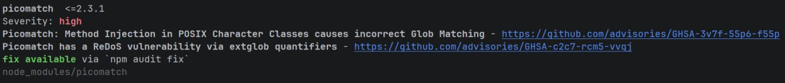
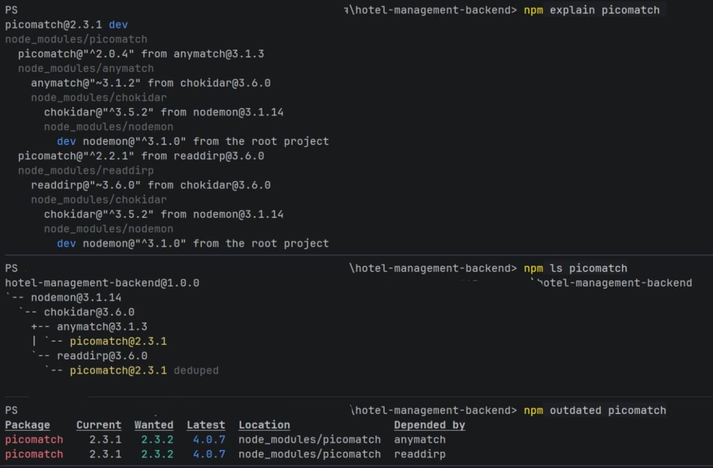
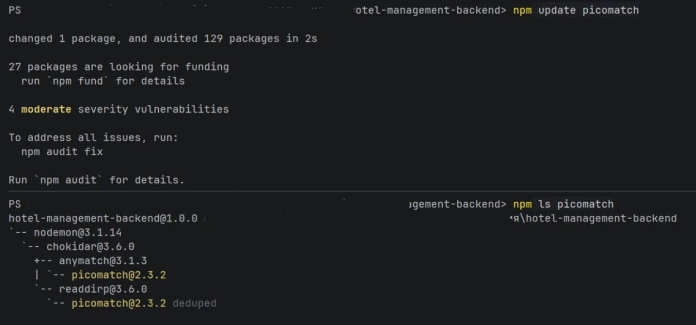
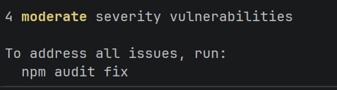

# High Vulnerability Investigation — picomatch

## 1. Project Overview

This investigation is part of my **Node.js Vulnerability Assessment & Remediation** project.

During a security scan of my Hotel Management System backend, I found two high-severity vulnerabilities in the `picomatch` package.

**Goal:** Understand the vulnerabilities, investigate the dependency chain, update the affected package, and verify the results.

**Application:** Hotel Management System (Node.js, Express, MySQL)

**Tools:** npm audit, npm explain, npm ls, npm outdated, PowerShell.

**Result:** Updated `picomatch` from version 2.3.1 to 2.3.2. Both vulnerable package findings were resolved according to the updated audit summary. The total number of reported vulnerabilities decreased from 5 to 4. The application continued working after the update.

---

## 2. Understanding the Vulnerability

### What is picomatch?

`picomatch` is a JavaScript package used to match file paths against patterns.

For example:

```text
**/*.js
```

This pattern matches JavaScript files in different folders.

Other examples:

| Pattern | Meaning |
|---|---|
| `*.js` | JavaScript files |
| `*.json` | JSON files |
| `src/**/*.js` | JavaScript files inside src and its subfolders |
| `*.{js,ts}` | JavaScript and TypeScript files |

Packages such as `anymatch` and `readdirp` use `picomatch` to work with file patterns.

### What is a Glob Pattern?

A **Glob Pattern** is a simple pattern used to find files.

For example, `*.js` means all files ending with `.js`.

It helps programs select files without specifying every filename individually.

---

## 3. What Vulnerabilities Were Found?

The initial `npm audit` identified two high-severity security issues.

### Vulnerability 1: Method Injection in POSIX Character Classes

**Advisory:** [GHSA-3v7f-55p6-f55p](https://github.com/advisories/GHSA-3v7f-55p6-f55p)

POSIX Character Classes are special character groups used in pattern matching.

They help identify categories of characters, such as letters or digits.

The vulnerability could cause specially prepared patterns to be processed incorrectly.

As a result, file matching could produce unexpected results.

### Vulnerability 2: ReDoS via Extglob Quantifiers

**Advisory:** [GHSA-c2c7-rcm5-vvqj](https://github.com/advisories/GHSA-c2c7-rcm5-vvqj)

**ReDoS (Regular Expression Denial of Service)** happens when specially prepared input causes a regular expression to take too much time to process.

Extglob is a pattern-matching feature that supports additional expressions.

Certain combinations of extglob quantifiers could cause excessive processing.

Possible consequences include:

- High CPU usage.
- Slow processing.
- Application delays.
- Denial of Service (DoS).

**Important:** These vulnerabilities were identified in the dependency. Their actual exploitability in this application was not established.

---

## 4. Vulnerability Details

| Field | Details |
|---|---|
| Package | picomatch |
| Severity | High |
| Vulnerable version | 2.3.1 |
| Updated version | 2.3.2 |
| Vulnerability types | Method Injection, ReDoS |
| Dependency source | anymatch, readdirp |
| Parent dependency | chokidar |
| Main development tool | nodemon |
| Dependency type | Development dependency |

---

## 5. Detection — Finding the Vulnerability

### Step 1: Run a Security Scan

Command:

```bash
npm audit
```

**What does this command do?**

`npm audit` checks project dependencies against known security advisories.

The initial scan identified two high-severity vulnerabilities in `picomatch`.



**Result:** Two security advisories were identified for the same package.

---

## 6. Dependency Investigation

### Step 2: Find the Dependency Chain

Command:

```bash
npm explain picomatch
```

**What does this command do?**

It explains why a package is installed and which other packages require it.

The investigation revealed two dependency paths:

```text
Hotel Management Backend
└── nodemon@3.1.14
    └── chokidar@3.6.0
        ├── anymatch@3.1.3
        │   └── picomatch@2.3.1
        └── readdirp@3.6.0
            └── picomatch@2.3.1
```

### Step 3: Check Installed Versions

Command:

```bash
npm ls picomatch
```

This command displays installed versions and their dependency relationships.

The result showed that both `anymatch` and `readdirp` used the same installed version of `picomatch`.

### What is Deduplication?

**Deduplication** means that npm can reuse one installed package version when multiple dependencies require compatible versions.

In this project, both dependency paths used the same `picomatch` installation.

### Step 4: Check Available Versions

Command:

```bash
npm outdated picomatch
```

The result showed:

| Field | Version |
|---|---|
| Current | 2.3.1 |
| Wanted | 2.3.2 |
| Latest | 4.0.7 |

**Why did I choose 2.3.2 instead of 4.0.7?**

The `Wanted` version is the newest version allowed by the existing dependency requirements.

Version 4.0.7 belongs to a different major release and could require compatibility changes.

Therefore, I selected version 2.3.2 to fix the vulnerabilities without unnecessarily changing the dependency structure.



**Result:** I identified the dependency chain and found a suitable updated version.

---

## 7. Remediation — Updating the Package

### Step 5: Update picomatch

Command:

```bash
npm update picomatch
```

**What does this command do?**

It updates the package to a newer version allowed by the dependency requirements.

The installed version changed:

**2.3.1 → 2.3.2**

The update changed one package.

### Step 6: Verify the Updated Version

Command:

```bash
npm ls picomatch
```

Expected dependency structure:

```text
nodemon@3.1.14
└── chokidar@3.6.0
    ├── anymatch@3.1.3
    │   └── picomatch@2.3.2
    └── readdirp@3.6.0
        └── picomatch@2.3.2 deduped
```

The output confirmed that both dependency paths used version 2.3.2.



**Result:** The vulnerable version was replaced with version 2.3.2.

---

## 8. Verification — Checking the Results

### Step 7: Security Rescan

I performed another security scan:

```bash
npm audit
```

The updated audit summary showed:

| Severity | Before Update | After Update |
|---|---:|---:|
| Critical | 0 | 0 |
| High | 1 | 0 |
| Moderate | 4 | 4 |
| **Total** | **5** | **4** |



**Result:** The two `picomatch` security findings were no longer reported, and the total number of vulnerabilities decreased from 5 to 4.

---

### Step 8: Application Test

After updating the dependency, I tested the Hotel Management System.

**Test results:**

- Backend started successfully.
- Frontend started successfully.
- Nodemon worked correctly.
- The application demo continued working.
- Login with an existing test account was successful.
- The application functionality tested during the demonstration worked correctly.

**Result:** The application continued working after the dependency update.

This was a functional test, not a complete security assessment of every application component.

---

## 9. Conclusion

During this investigation, I:

1. Detected two high-severity vulnerabilities using `npm audit`.
2. Learned how `picomatch` works.
3. Studied Glob Patterns and file matching.
4. Learned about POSIX Character Classes and Extglob.
5. Investigated the dependency chain using `npm explain`.
6. Checked installed versions using `npm ls`.
7. Checked available versions using `npm outdated`.
8. Updated `picomatch` from 2.3.1 to 2.3.2.
9. Verified the updated dependency tree.
10. Repeated the security scan.
11. Tested the backend, frontend, and user authentication.

### Final Results

- **Package:** picomatch
- **Version:** 2.3.1 → 2.3.2
- **Parent dependency:** chokidar
- **Main development tool:** nodemon
- **Dependency type:** Development dependency
- **Security findings:** Two High findings resolved
- **Total vulnerabilities:** 5 → 4
- **Remaining findings:** 4 Moderate
- **Backend:** Working
- **Frontend:** Working
- **Login test:** Successful

**Final Status: Updated and Verified**

The vulnerable package was updated to version 2.3.2. The updated audit summary no longer reported the two `picomatch` findings, and the application passed the functional tests.

**Security Note:** The investigation confirmed vulnerable dependency versions and their remediation. Actual exploitability in this specific application was not established.

---

## 10. Key Terms

| Term | Simple Definition |
|---|---|
| picomatch | A package that matches file paths against patterns. |
| Glob Pattern | A pattern used to find files. |
| POSIX Character Classes | Special groups of characters used in patterns. |
| Extglob | An extended pattern-matching feature. |
| ReDoS | An attack that makes regular expression processing take too long. |
| DoS | An attack that makes a service unavailable. |
| anymatch | A package that checks whether values match patterns. |
| readdirp | A package that reads directory contents. |
| chokidar | A package that watches file system changes. |
| nodemon | A development tool that automatically restarts Node.js. |
| Deduplication | Reusing one compatible installed package version. |
| Remediation | Fixing or reducing a security problem. |
| Verification | Checking that a fix works correctly. |

---

## 11. References

- [picomatch — npm](https://www.npmjs.com/package/picomatch)
- [anymatch — npm](https://www.npmjs.com/package/anymatch)
- [chokidar — npm](https://www.npmjs.com/package/chokidar)
- [GHSA-3v7f-55p6-f55p](https://github.com/advisories/GHSA-3v7f-55p6-f55p)
- [GHSA-c2c7-rcm5-vvqj](https://github.com/advisories/GHSA-c2c7-rcm5-vvqj)
- [npm audit Documentation](https://docs.npmjs.com/cli/commands/npm-audit)
