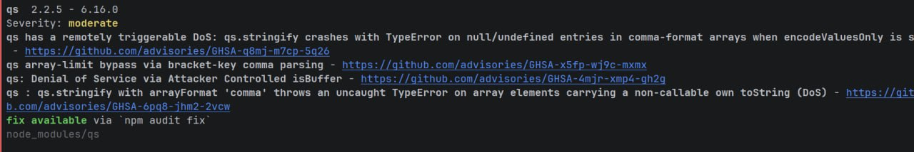
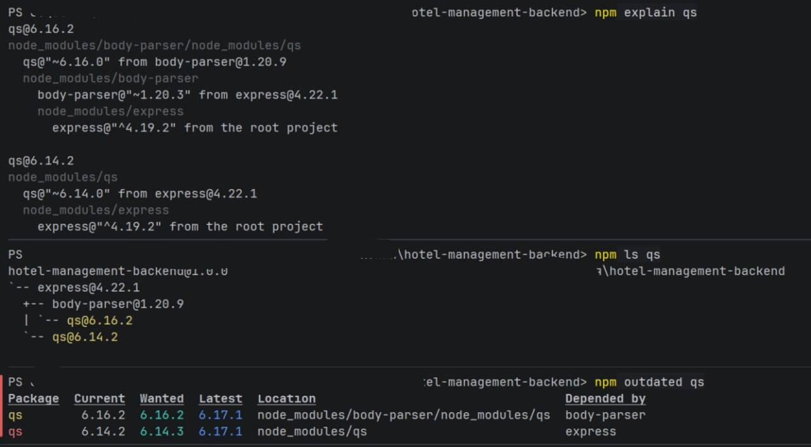
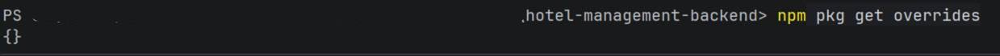
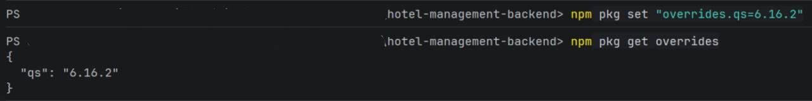
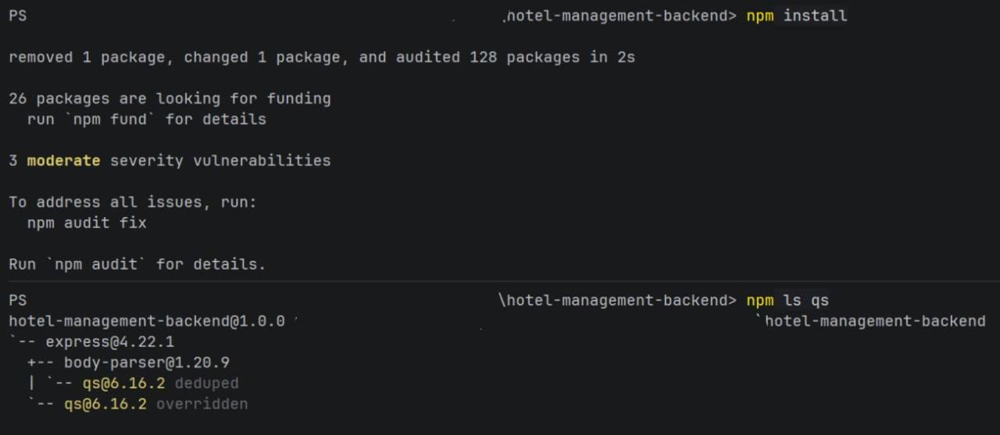
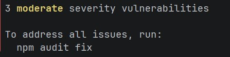

# Moderate Vulnerability Investigation — qs

## 1. Project Overview

This investigation is part of my **Node.js Vulnerability Assessment & Remediation** project.

During a security scan of my Hotel Management System backend, I discovered four security advisories affecting the `qs` package.

The package was installed in two different versions through Express and body-parser.

**Goal:** Understand the vulnerabilities, investigate the dependency tree, update the vulnerable package, and verify that the application continues working.

**Application:** Hotel Management System (Node.js, Express, MySQL)

**Tools:** npm audit, npm explain, npm ls, npm outdated, npm overrides, PowerShell.

**Result:** Updated both dependency paths to `qs@6.16.2` using npm overrides. The final audit summary showed 3 remaining moderate vulnerabilities, compared with 4 before remediation. The backend, frontend, and user authentication continued working.

---

## 2. Understanding qs

### What is qs?

`qs` is a JavaScript library used to parse and stringify URL query strings.

In simple words, it helps convert URL parameters into JavaScript objects and JavaScript objects into URL parameters.

For example, imagine a hotel booking request:

```text
/api/rooms?type=deluxe&price=2500
```

The server receives two parameters:

- type = deluxe
- price = 2500

The `qs` library can convert them into an object:

```javascript
const qs = require('qs');

const result = qs.parse('type=deluxe&price=2500');

console.log(result);
```

Output:

```javascript
{
  type: 'deluxe',
  price: '2500'
}
```

### What is a nested query?

The library can also process more complex parameters.

Example:

```text
user[name]=Anna&user[age]=25
```

Output:

```javascript
{
  user: {
    name: 'Anna',
    age: '25'
  }
}
```

### What is stringify?

The opposite operation is called `stringify`.

It converts a JavaScript object into a URL query string.

Example:

```javascript
const data = {
  type: 'deluxe',
  price: 2500
};

console.log(qs.stringify(data));
```

Output:

```text
type=deluxe&price=2500
```

**Why is this important?**

Web applications use URL parameters to exchange information between clients and servers. Incorrect processing of specially prepared input can create security problems.

---

## 3. Understanding the Vulnerabilities

The initial `npm audit` identified four security advisories affecting `qs`.

All four were classified as Moderate severity.

### Vulnerability 1: qs.stringify TypeError

Advisory: [GHSA-q8mj-m7cp-5q26](https://github.com/advisories/GHSA-q8mj-m7cp-5q26)

Certain specially prepared arrays containing null or undefined values could cause `qs.stringify` to crash with a TypeError.

Possible consequence:

- Application errors.
- Process interruption.
- Denial of Service (DoS).

### Vulnerability 2: Array-limit bypass

Advisory: [GHSA-x5fp-wj9c-mxmx](https://github.com/advisories/GHSA-x5fp-wj9c-mxmx)

The library has limits on the number of elements it processes in arrays.

The vulnerability allowed specially constructed query parameters to bypass certain array limits.

This could cause unexpected input processing and excessive resource consumption.

### Vulnerability 3: Attacker-controlled isBuffer

Advisory: [GHSA-4mjr-xmp4-gh2g](https://github.com/advisories/GHSA-4mjr-xmp4-gh2g)

Specially prepared input could exploit the handling of attacker-controlled `isBuffer` properties.

Possible consequence:

- Application crashes.
- Unexpected processing behavior.
- Denial of Service.

### Vulnerability 4: qs.stringify with comma arrays

Advisory: [GHSA-6pq8-jhm2-2vcw](https://github.com/advisories/GHSA-6pq8-jhm2-2vcw)

When using `arrayFormat: 'comma'`, specially prepared array elements could cause an uncaught TypeError.

Possible consequence: application interruption and Denial of Service.

### What is DoS?

**DoS (Denial of Service)** is an attack that makes a service unavailable or prevents it from working normally.

For example:

- The server receives specially prepared requests.
- Processing causes excessive resource usage or an application error.
- The application becomes slow or stops responding.
- Users may temporarily lose access.

These advisories describe potential security risks. Actual exploitation in this application was not established.

---

## 4. Vulnerability Details

| Field | Details |
|---|---|
| Package | qs |
| Severity | Moderate |
| Vulnerable range | 2.2.5 – 6.16.0 |
| Selected fixed version | 6.16.2 |
| Vulnerability types | DoS, Array-limit bypass |
| Number of advisories | 4 |
| Main dependencies | Express, body-parser |

---

## 5. Detection — Finding the Vulnerability

### Step 1: Run npm audit

Command:

```bash
npm audit
```

This command checks installed project dependencies against known security advisories.

The initial scan identified four security advisories affecting `qs`.



**Result:** Four Moderate security findings were identified.

---

## 6. Dependency Investigation

### Step 2: Find the dependency chain

Command:

```bash
npm explain qs
```

This command explains why a package is installed and which dependencies require it.

The investigation showed two different versions:

```text
express@4.22.1
├── body-parser@1.20.9
│   └── qs@6.16.2
└── qs@6.14.2
```

### Step 3: Check installed versions

Command:

```bash
npm ls qs
```

This command displays the installed versions and their dependency relationships.

The output confirmed that the project contained two versions of `qs`:

- 6.16.2 through body-parser.
- 6.14.2 through Express.

### Step 4: Check available versions

Command:

```bash
npm outdated qs
```

Results:

| Dependency | Current | Wanted | Latest |
|---|---|---|---|
| qs through body-parser | 6.16.2 | 6.16.2 | 6.17.1 |
| qs through Express | 6.14.2 | 6.14.3 | 6.17.1 |

The version `6.14.3` was still within the vulnerable range.

Therefore, a normal update within the existing dependency requirements was not sufficient.



**Result:** I identified two installed versions and found that the older version needed to be replaced.

---

## 7. Understanding npm Overrides

### What are npm overrides?

`overrides` is a feature in npm that allows developers to force a specific version of a dependency.

This is useful when a vulnerable package is installed indirectly through another library.

For example:

```text
My Application
└── Express
    └── qs@6.14.2
```

Express requests an older compatible version of `qs`.

Instead of manually changing Express, I can use npm overrides to specify a newer version.

In this project, I selected `qs@6.16.2`.

### Step 5: Check existing overrides

Command:

```bash
npm pkg get overrides
```

Output:

```json
{}
```

This confirmed that no overrides were configured.



### Step 6: Add an override

Command:

```bash
npm pkg set "overrides.qs=6.16.2"
```

Then I verified the configuration:

```bash
npm pkg get overrides
```

Output:

```json
{
  "qs": "6.16.2"
}
```

The configuration was added to `package.json`:

```json
"overrides": {
  "qs": "6.16.2"
}
```

This tells npm to use version 6.16.2 instead of the older transitive version.



---

## 8. Remediation — Updating the Dependency

### Step 7: Apply the override

Command:

```bash
npm install
```

This command reads the updated `package.json`, applies the override, installs the required dependency versions, and updates `package-lock.json`.

The installation completed successfully.

### Step 8: Verify installed versions

Command:

```bash
npm ls qs
```

Final dependency tree:

```text
hotel-management-backend
└── express@4.22.1
    ├── body-parser@1.20.9
    │   └── qs@6.16.2 deduped
    └── qs@6.16.2 overridden
```

### Understanding the output

**overridden** means npm applied the version specified in the overrides configuration.

**deduped** means npm reused an already installed compatible package instead of installing another copy.

The result confirmed that both dependency paths now used `qs@6.16.2`.



**Result:** Both installed versions were aligned to the selected updated version.

---

## 9. Security Rescan

### Step 9: Run the final security scan

Command:

```bash
npm audit
```

The final audit summary showed:

**3 Moderate severity vulnerabilities.**

Comparison:

| Metric | Before | After |
|---|---:|---:|
| Moderate vulnerabilities | 4 | 3 |
| qs versions | 2 | 1 |
| qs installed version | 6.14.2 / 6.16.2 | 6.16.2 |

The final audit summary showed one fewer Moderate vulnerability after the update.



**Result:** The dependency update was applied successfully. Three Moderate vulnerabilities remained in other dependencies and require separate investigation.

---

## 10. Application Testing

After updating `qs`, I tested the Hotel Management System.

### Test results

- Backend started successfully.
- Frontend started successfully.
- The application demo worked correctly.
- Login with an existing test account was successful.
- Authentication continued working.
- The application remained functional after the dependency update.

**Result:** All performed functional checks passed.

This was a functional test, not a complete security assessment of the application.

---

## 11. Conclusion

During this investigation, I:

1. Detected four Moderate security advisories using `npm audit`.
2. Learned how the `qs` library parses and stringifies URL parameters.
3. Investigated the dependency tree using `npm explain`.
4. Identified two different installed versions of `qs`.
5. Checked available versions using `npm outdated`.
6. Learned how npm overrides work.
7. Added an override for `qs@6.16.2`.
8. Updated the dependency tree using `npm install`.
9. Verified that both dependency paths used version 6.16.2.
10. Performed a final security scan.
11. Tested the backend, frontend, and user authentication.

### Final Results

| Item | Result |
|---|---|
| Package | qs |
| Previous vulnerable version | 6.14.2 |
| Updated version | 6.16.2 |
| Remediation method | npm overrides |
| Dependency paths | Express and body-parser |
| Initial Moderate findings | 4 |
| Final Moderate findings | 3 |
| Backend | Working |
| Frontend | Working |
| Authentication | Successful |

**Final Status: Updated and Functionally Verified**

The `qs` dependency was updated using npm overrides. Both dependency paths now use version 6.16.2, and the application continued working after the update.

Three Moderate vulnerabilities remain in other dependencies and will be investigated separately.

---

## 12. Key Terms

| Term | Simple Definition |
|---|---|
| qs | A library for processing URL query parameters. |
| Parse | Convert a query string into a JavaScript object. |
| Stringify | Convert a JavaScript object into a query string. |
| Query Parameters | Values sent through a URL. |
| DoS | An attack that makes a service unavailable. |
| TypeError | An error caused by an operation on an unexpected data type. |
| Transitive Dependency | A package required by another installed package. |
| npm overrides | A feature for forcing specific dependency versions. |
| Dependency Tree | A structure showing which packages depend on other packages. |
| Deduplication | Reusing one compatible package installation. |
| Remediation | Fixing a security vulnerability. |
| Verification | Checking whether a fix was successful. |

---

## 13. References

- [qs — npm](https://www.npmjs.com/package/qs)
- [Express — npm](https://www.npmjs.com/package/express)
- [npm Overrides Documentation](https://docs.npmjs.com/cli/v11/configuring-npm/package-json#overrides)
- [npm audit Documentation](https://docs.npmjs.com/cli/commands/npm-audit)
- [GHSA-q8mj-m7cp-5q26](https://github.com/advisories/GHSA-q8mj-m7cp-5q26)
- [GHSA-x5fp-wj9c-mxmx](https://github.com/advisories/GHSA-x5fp-wj9c-mxmx)
- [GHSA-4mjr-xmp4-gh2g](https://github.com/advisories/GHSA-4mjr-xmp4-gh2g)
- [GHSA-6pq8-jhm2-2vcw](https://github.com/advisories/GHSA-6pq8-jhm2-2vcw)
